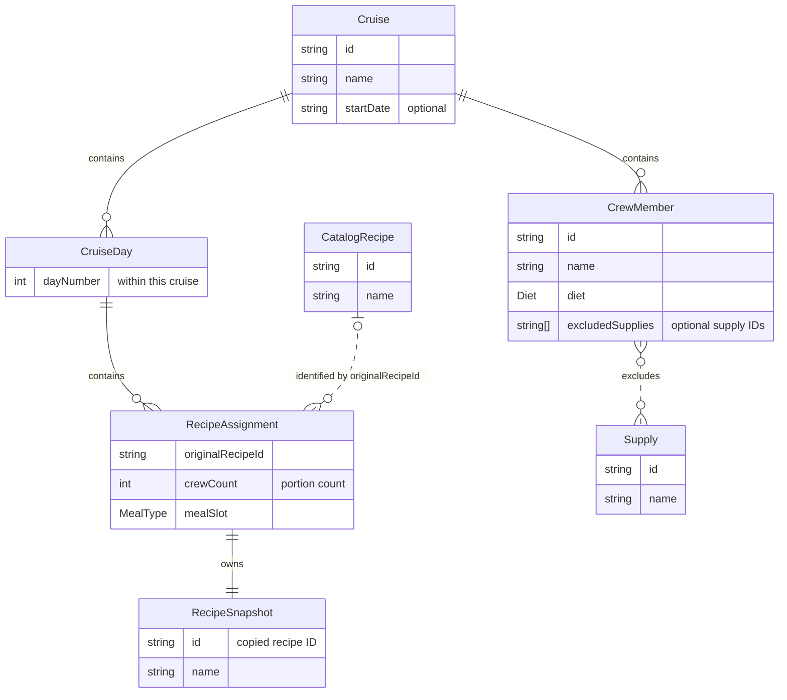
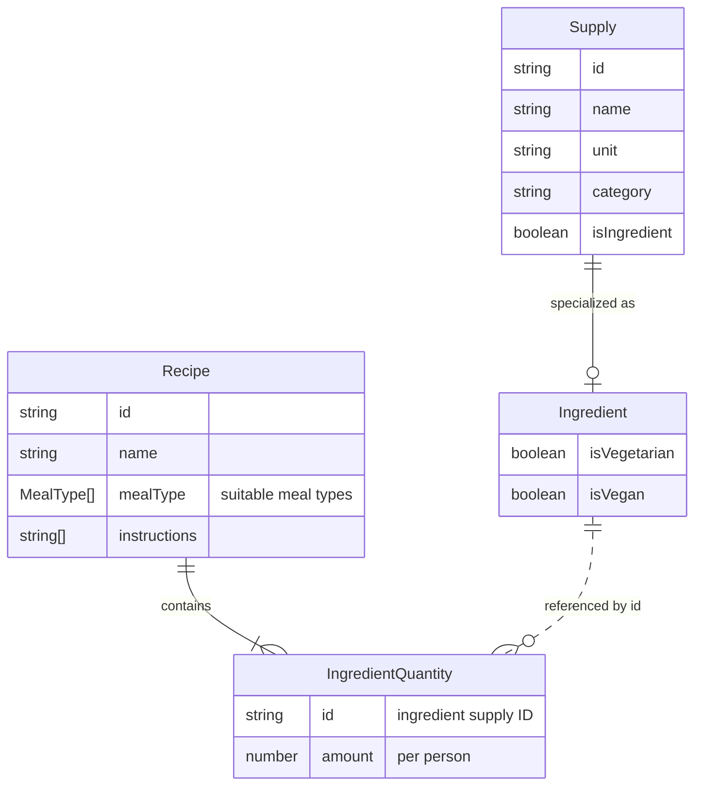
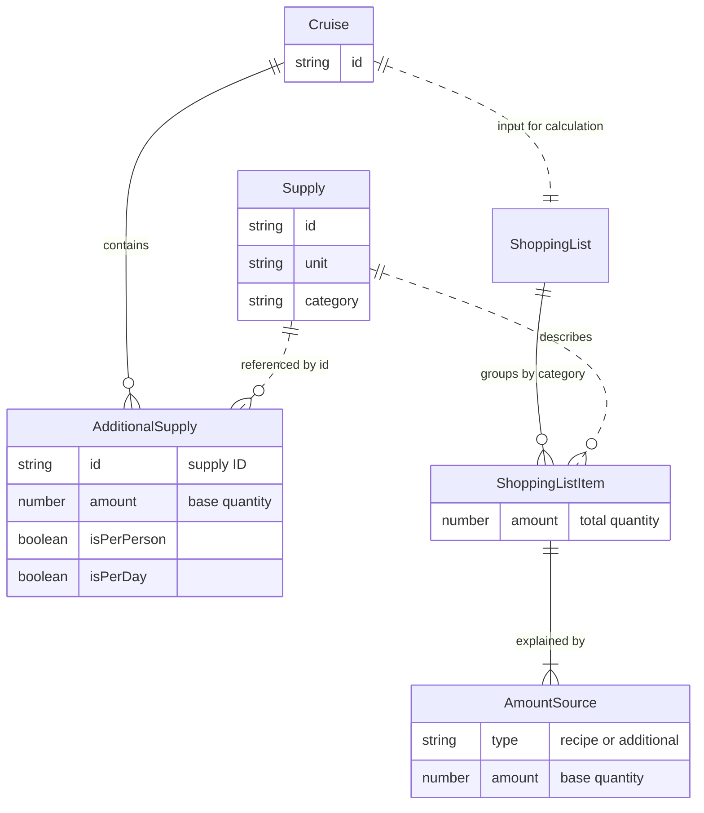

# Domain Entity Diagrams

These diagrams describe the current domain model using the terms in [GLOSSARY.md](../GLOSSARY.md). They show embedded values and catalog references, not database tables or a proposed redesign. Only fields relevant to the relationships are included.

In Mermaid's cardinality notation, `||` means exactly one, `o|` means zero or one, `o{` means zero or more, and `|{` means one or more. Solid relationships show ownership or specialization; dashed relationships show references. Cardinalities describe the intended relationships for valid data; catalog IDs are not enforced foreign keys.

## Cruise, crew, and meal plan

- Crew is the cruise's collection of crew members, not a separate record. A crew member has one diet: `omnivore`, `vegetarian`, or `vegan`. Exclusions reference supplies independently of diet.
- A cruise day belongs to one cruise. `dayNumber` identifies its position within that cruise, not a global day entity.
- A recipe assignment belongs to one day and owns one recipe snapshot. `originalRecipeId` records its catalog origin; the snapshot remains available even when that catalog lookup fails. Multiple assignments can originate from the same catalog recipe.
- A meal slot is identified by a day and a meal type. It is represented by `RecipeAssignment.mealSlot`, not a separate object. Multiple assignments can share the same slot. Meal types are `śniadanie`, `obiad`, `kolacja`, and `przekąska`.
- `crewCount` means portions for that assignment, not the number of people in the cruise's crew.

Source: [cruise.ts](../src/model/cruise.ts), [crew.ts](../src/model/crew.ts), [cruiseDietCoverage.ts](../src/model/cruiseDietCoverage.ts).

## Recipes, ingredients, and catalog supplies

- The recipe structure applies to both catalog recipes and assignment snapshots. A snapshot can be edited independently of the catalog recipe.
- An ingredient is a specialization of a supply with the same identity, not a second catalog entry. Supplies also include non-food products.
- Ingredient quantity is an embedded value containing a supply ID and an amount per person. It is not the ingredient catalog record itself.
- `mealType` describes the recipe's suitable meal types; `mealSlot` places one assignment in a day's plan.
- Valid new recipes have at least one ingredient quantity. Ingredient IDs should resolve to ingredient supplies; missing references and older snapshots can still occur in stored data.

Source: [recipe.ts](../src/model/recipe.ts), [supply.ts](../src/model/supply.ts), [recipieData.ts](../src/model/recipieData.ts).

## Additional supplies and derived shopping list

- Shopping list and its items are calculated results, not separately persisted entities. The list is a category-to-items mapping. Each item combines all contributions for one supply ID.
- An additional supply is identified within a cruise by `(id, isPerPerson, isPerDay)`. One product can have several entries with different scaling flags.
- A recipe contribution is `ingredient amount per person × assignment portion count`.
- An additional supply contribution is `base amount × crew multiplier × day multiplier`. The multipliers are crew size when `isPerPerson` is true and cruise day count when `isPerDay` is true; otherwise each is 1.
- Amount sources preserve the explanation of each contribution: recipe sources include recipe name, day number, and portion count; additional supply sources include scaling flags. They do not store references to assignment objects.
- Missing supply IDs produce placeholder supplies in the shopping list rather than dropping the contribution.

Source: [shoppingList.ts](../src/model/shoppingList.ts), [cruise.ts](../src/model/cruise.ts).

## Mapping discussion terms to code

| Diagram term | Current representation |
| --- | --- |
| Cruise | `Cruise` |
| Cruise day | `CruiseDay` |
| Crew member | `CrewMember` |
| Recipe assignment | `CruiseDayRecipe` |
| Catalog recipe / recipe snapshot | `Recipie` / `CruiseDayRecipe.recipeData` |
| Ingredient quantity | `IngredientAmount` |
| Supply / ingredient | `Supply` / `Ingredient extends Supply` |
| Additional supply | `CruiseSupply` |
| Shopping list / item | `AggregatedShoppingList` / `AggregatedItem` |
| Amount source | `RecipeAmountSource` or `AdditionalSupplyAmountSource` |

The spelling `recipie` remains intentional in code. Conceptual roles such as recipe snapshot and meal slot do not imply additional classes or storage records.
